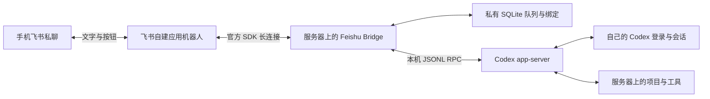

# Clawbot 飞书 Codex Agent 部署指南

核对日期：2026-11-13。适用对象：希望在自己的 Linux 服务器上部署一个能通过手机飞书持续对话、读写文件、执行命令的 Codex Agent 的用户。

本文对应本项目的飞书桥接实现。每个人使用自己的飞书自建应用、自己的 Codex 账号和独立状态目录；不需要复制原部署者的登录、历史或绑定信息。

## 1. 部署后可以做什么

- 手机飞书私聊机器人，连续对话，让 Codex 查看项目、修改代码、运行服务器上的命令。
- 在卡片里新建、切换、分支会话，查看历史、选择模型与推理强度、调整权限、停止当前回复。
- 通过同一个 Codex Home 保留上下文；重启机器人后仍可以找到已保存的会话。
- 接收脚本主动发出的完成通知或故障通知。定时巡检和自动修复需要业务脚本另行接入，机器人本身不等于训练调度器。
- 图片可作为模型原生图片输入；语音需要额外的本地音频环境，文字对话无需 GPU 或音频模型。



服务器主动建立飞书长连接，不需要公网入站端口、域名、Cloudflare 或 VS Code Tunnel。服务器仍需能访问飞书开放平台和自己的 Codex 服务端。长连接及消息、卡片接口使用官方 [飞书 Python SDK](https://github.com/larksuite/oapi-sdk-python)；本项目通过本机标准输入/输出连接 [Codex app-server](https://learn.chatgpt.com/docs/app-server)。

## 2. 准备材料与目录

需要：Linux、Python 3.10 或更新版本、`python3-venv`、`pip`、`tmux`、已安装的 Codex CLI，以及可以创建和发布飞书自建应用的账号。先用同一个普通 Linux 用户完成安装与启动。

Ubuntu / Debian 缺少基础工具时，由有权限的用户安装：

```bash
sudo apt-get update
sudo apt-get install -y python3 python3-venv python3-pip tmux curl ca-certificates
```

拿到随本文提供的 `clawbot-feishu-deploy-20261113.tar.gz`，将它传到自己的服务器。例如放在自己的 `~/Downloads`：

```bash
mkdir -p "$HOME/apps"
tar -xzf "$HOME/Downloads/clawbot-feishu-deploy-20261113.tar.gz" -C "$HOME/apps"
cd "$HOME/apps/clawbot-feishu"
```

分发包只包含必要程序、测试、依赖说明和本文。**Markdown 是操作指南，运行时还需要这份源码包。** 包内 `SHA256SUMS` 可用于核对文件：

```bash
sha256sum -c SHA256SUMS
```

建议布局：

```text
~/apps/clawbot-feishu/                 程序和 Python 虚拟环境
~/.local/share/clawbot/codex/          自己的 Codex 登录、配置与历史
~/.local/share/clawbot/feishu/         自己的飞书凭据、绑定、队列与日志
~/workspace/                          Agent 的默认项目目录
```

没有本机 GPU 也可以先完成文字、按钮和图片部署。Agent 执行的是这台服务器上的工具；若要操作远程集群，应另外给这个 Linux 用户配置相应权限。

## 3. 安装 Codex，并显式设置四个环境变量

如果服务器已经有可用的 Codex，可跳过安装；否则按 [OpenAI Docs 的 Codex CLI 安装说明](https://learn.chatgpt.com/docs/cli) 安装。当前官方提供以下 Linux 安装入口：

```bash
curl -fsSL https://chatgpt.com/codex/install.sh | sh
```

确保当前终端的 `PATH` 能找到安装好的二进制：

```bash
command -v codex
codex --version
```

在程序目录复制环境模板：

```bash
cd "$HOME/apps/clawbot-feishu"
cp deploy.env.example deploy.env
chmod 600 deploy.env
```

`deploy.env` 内容如下，可改成自己的绝对路径。**四个变量都要设置**，原始管理脚本保留了旧部署的默认值，不能直接依赖默认路径。

```bash
export CODEX_HOME="$HOME/.local/share/clawbot/codex"
export CODEX_BRIDGE_PROJECT="$HOME/workspace"
export CODEX_FEISHU_STATE="$HOME/.local/share/clawbot/feishu"
CODEX_BRIDGE_BIN="$(command -v codex)" || return 1
export CODEX_BRIDGE_BIN
```

也可把最后两行改成 `export CODEX_BRIDGE_BIN=/实际安装位置/codex`。显式路径可以避免程序自动优先选择另一份 VS Code 扩展内的 Codex。

加载环境并创建目录：

```bash
source ./deploy.env
umask 077
mkdir -p "$CODEX_HOME" "$CODEX_FEISHU_STATE" "$CODEX_BRIDGE_PROJECT"
chmod 700 "$CODEX_HOME" "$CODEX_FEISHU_STATE"
unset CODEX_THREAD_ID CODEX_TURN_ID
"$CODEX_BRIDGE_BIN" --version
```

`CODEX_BRIDGE_PROJECT` 用于默认工作目录和会话列表筛选，**不是 Full access 下的系统访问边界**。本实现保留“飞书新建会话默认 Full access”：`danger-full-access`、`approvalPolicy=never`，因此 Agent 具有启动它的 Linux 用户所拥有的实际权限。管理员限制仍然生效。部署者应理解这个默认行为，需要限制时可在首次任务前用权限菜单选择更受限模式。

## 4. 登录自己的 Codex，并初始化会话索引

远程服务器推荐设备码登录：

```bash
source ./deploy.env
"$CODEX_BRIDGE_BIN" login --device-auth
"$CODEX_BRIDGE_BIN" login status
```

打开终端提示的官方地址，使用**自己的账号**授权并输入临时代码。该方式需要账号或工作区允许设备码登录；如果不可用，参考 [OpenAI Docs 登录说明](https://learn.chatgpt.com/docs/auth?surface=cli) 的 SSH 回调方案。已有登录仅在使用同一 `CODEX_HOME` 时复用；切换到本文的新 Home 后需要在这个 Home 登录。

登录成功后，还要完成一次最小对话，让 Codex 创建真实会话索引。不要使用 `--ephemeral`：

```bash
"$CODEX_BRIDGE_BIN" -c approval_policy='"never"' exec \
  --sandbox read-only \
  --skip-git-repo-check \
  -C "$CODEX_BRIDGE_PROJECT" \
  '只回复 CODEX_READY，不读取或修改文件，不运行命令。'
```

确认输出包含 `CODEX_READY`，并检查索引：

```bash
python3 - <<'PY'
import os
from pathlib import Path
home = Path(os.environ['CODEX_HOME'])
assert list(home.glob('state_*.sqlite')), '请先在同一 CODEX_HOME 完成一次持久化 Codex 对话'
print('Codex 会话索引已建立')
PY
```

只执行 `codex login` 不一定创建索引；这正是新机器容易出现“找不到所选 CODEX_HOME 的会话索引”的原因。

## 5. 安装桥接依赖并做本机预检

在程序目录执行：

```bash
python3 -m venv .venv_feishu
.venv_feishu/bin/python -m pip install -r requirements-feishu.txt -c deployment-constraints.txt
```

`requirements-feishu.txt` 引用了 `requirements-wechat.txt`，这里是复用 requests、cryptography 等基础依赖，**不会启动微信机器人**。

验证包内模块、SDK 和自己的 Codex 接口：

```bash
source ./deploy.env
.venv_feishu/bin/python - <<'PY'
import os
from pathlib import Path
import feishu_bot, feishu_media
from lark_oapi.event.callback.model.p2_card_action_trigger import P2CardActionTriggerResponse
from bridge_state import Catalog
from codex_rpc import CodexRPC

catalog = Catalog(Path(os.environ['CODEX_HOME']), Path(os.environ['CODEX_BRIDGE_PROJECT']))
rpc = CodexRPC(catalog.home, catalog.project, binary=os.environ['CODEX_BRIDGE_BIN'])
try:
    models = rpc.call('model/list', {'limit': 100, 'includeHidden': False})
    assert models.get('data'), '当前账号未返回可用模型'
    rpc.call('configRequirements/read', {})
    print('模块、会话索引、app-server 握手、模型列表及权限接口通过')
finally:
    rpc.close()
PY
```

不要在安装时把某个固定模型名称写死。模型菜单来自当前登录账号的 `model/list`。如果接口不兼容，先核对 `CODEX_BRIDGE_BIN` 与版本；本桥接还读取本地 `state_*.sqlite`，不能保证未来任意 Codex 版本都无需适配。

维护者核对的原部署版本为 Codex CLI `0.164.0-alpha.11.1`、Python `3.10.19`、`lark-oapi 1.7.4`、`websockets 15.0.1`、`Pillow 11.3.0`。这里记录的是参考环境，不是承诺某个安装渠道始终提供该 alpha 版本。飞书 SDK 按包内依赖固定安装，先不要自行整体升级。

## 6. 创建自己的飞书应用

打开 [飞书开放平台](https://open.feishu.cn/app)，创建**企业自建应用**，例如“我的 Codex Agent”，启用机器人能力。组织可能需要管理员批准创建、权限或发布。

配置项目：

| 项目 | 设置 |
| --- | --- |
| 发送消息权限 | `im:message:send_as_bot`，以应用身份发送消息 |
| 私聊消息权限 | `im:message.p2p_msg:readonly`，获取用户发给机器人的单聊消息 |
| 消息事件 | `im.message.receive_v1` |
| 卡片回调 | `card.action.trigger` |
| 接收方式 | 消息事件与卡片回调**分别**选择长连接 |
| 可用范围 | 至少包括实际要绑定的用户 |

只添加群自定义机器人的 Webhook 不够；本实现需要双向消息和按钮交互。消息事件能收到，不代表按钮回调已经配好。新应用使用上述 `:readonly` 私聊权限；旧说明中的 `im:message.p2p_msg` 是历史权限，不应作为新部署唯一要找的权限名，参见官方 [消息 FAQ](https://open.feishu.cn/document/uAjLw4CM/ukTMukTMukTM/reference/im-v1/guide/faq)。操作入口参见官方 [事件处理](https://open.feishu.cn/document/uAjLw4CM/ukTMukTMukTM/server-side-sdk/python--sdk/handle-events) 和 [卡片回调处理](https://open.feishu.cn/document/uAjLw4CM/ukTMukTMukTM/server-side-sdk/python--sdk/handle-callbacks)。

在应用后台取得 App ID 与 App Secret，然后在服务器交互式配置：

```bash
source ./deploy.env
bash manage_feishu.sh configure
```

终端会分别询问 ID 和 Secret；Secret 隐藏输入，保存在自己的私有状态目录。程序会输出本次绑定口令，例如 `/绑定 一次性校验码`。保存这个临时口令，稍后在手机上使用。已有 `config.json` 时配置器拒绝覆盖，避免误清已有绑定。

若后台保存长连接订阅时提示未建立连接，先启动服务器端：

```bash
bash manage_feishu.sh start
bash manage_feishu.sh status
```

再回飞书后台完成事件、回调订阅并发布应用版本，使机器人对自己可用。调整权限或可用范围后，按组织要求完成重新发布或审批。

## 7. 手机绑定和第一次对话

1. 在手机飞书找到刚发布的应用机器人，打开私聊。
2. 发送服务器配置时显示的 `/绑定 校验码`。
3. 收到菜单后点击“新建”，然后发送：`先告诉我当前工作目录，只检查，不修改文件。`
4. 确认手机收到真实 Codex 回复，并点击“当前”“历史”检查会话能持续使用。
5. 再问一个依赖上一轮上下文的问题，验证它不是每条消息都重开会话。

菜单大致为：

```text
会话操作
[会话] [当前] [历史]
[新建] [分支] [停止]
[一键解锁全部会话]

会话设置
[选择模型] [推理强度] [权限]
```

要点：

- 只接受已绑定用户在已绑定私聊里的任务，其他人或群聊不能直接控制。
- 没有选中会话时，先选择或新建，再提交任务；不要把“会话”列表当成已经选中。
- 同一个会话被桌面 Codex 占用时，可以只看历史，或明确“分支”后继续。
- “停止”中断当前桥接发起的 Codex 回合；已经独立启动的训练、推理等进程不一定随之退出。
- “一键解锁全部会话”会断开同一个 Codex Home 的占用 app-server，可能同时中断桌面客户端回复，不能当作日常连通性测试。
- 历史会话和长回复保留在本地；模型、权限与推理强度按会话保存，通常从下一轮生效。

## 8. 日常启动、日志和断线

每个新终端先加载环境：

```bash
cd "$HOME/apps/clawbot-feishu"
source ./deploy.env
bash manage_feishu.sh status
```

启动、停止：

```bash
bash manage_feishu.sh start
bash manage_feishu.sh stop
```

查看日志：

```bash
tail -n 80 "$CODEX_FEISHU_STATE/service.log"
```

当前管理脚本使用 `houyi-feishu-codex` 这个 tmux 会话名；名字可以保留。它在**同一个 Linux 用户**下按单实例使用，不要在该用户下再用同名 tmux 部署第二个机器人。多人使用时，各用独立 Linux 用户、飞书应用、Codex Home 和飞书状态目录。

tmux 不依赖当前 SSH 窗口，退出 SSH 后机器人继续运行；机器或容器重启后需重新执行 `start`。如需系统开机自启，可另行用 systemd 托管 `feishu_bot.py serve`，与 tmux 二选一，不能让二者并行消费同一状态目录。

`status` 预期同时满足 `configured=true`、`bound=true`、`running=true`、最新 health 的 `status=connected`。还要检查 health 更新时间。**最终验收以“手机发出任务 → 服务器实际执行 → 手机收到回复”为准**，不是只有 tmux 存在或 connected 就完成。

## 9. 可选：脚本向自己的手机发通知

绑定并启动服务后，业务脚本可以把通知写入已有出站队列，由机器人发送。以下只发给该实例已绑定的用户，不需要在脚本里硬编码 App Secret 或收件人：

```bash
source ./deploy.env
.venv_feishu/bin/python - <<'PY'
import json, os
from pathlib import Path
from bridge_state import Store

state = Path(os.environ['CODEX_FEISHU_STATE'])
config = json.loads((state / 'config.json').read_text())
owner = config.get('owner_open_id')
assert owner, '请先在手机完成绑定'
store = Store(state)
try:
    assert store.get('chat:' + owner), '缺少已绑定私聊'
    store.enqueue(owner, '任务已完成。请打开结果页面查看。')
    print('通知已入队；仍需核对平台发送与手机收信')
finally:
    store.db.close()
PY
```

重复执行此示例会重复入队；周期性监控应另外按事件 ID 去重，只发送关键成果和故障。通知发送不等于自动触发新的 Codex 任务；如需后台自检与恢复，应明确设计事件入口和唯一任务控制者。

## 10. 可选：图片和语音

文字跑通后再测试附件，附件不是基础文字部署的依赖。

**图片：** 应用需具备当前资源下载接口要求的权限；权限名称以飞书后台及接口返回为准，不要只因能收文字就假定能下载图片。实现使用 `GetMessageResourceRequest`，错误时会报告平台错误码及可提取的权限项。下载后校验图片，再作为 Codex `localImage` 输入。每条最多 8 张，每张原始文件不超过 20 MiB。

**语音：** 另建程序目录下的 `.venv_audio`，准备 FFmpeg、本地 Qwen2.5-Omni-3B 权重和音频依赖。用 `CODEX_VOICE_MODEL` 指向自己的权重目录，启动前导出并确认它已传入服务进程；当前 tmux 管理脚本只显式传递四个基础环境变量，需在启动命令或 tmux 环境中另外配置此可选变量。

参考环境为 torch `2.5.1`、transformers `5.14.1`、accelerate `1.10.1`、soundfile `0.13.1`、numpy `2.2.6`、librosa `0.11.0`、qwen-omni-utils `0.0.9`。`requirements-audio.txt` 只补充 qwen-omni-utils，并非一份完整独立音频环境锁文件；不能只安装它就认为语音已部署。

飞书语音经 FFmpeg 解码为 16 kHz 单声道 WAV，再由本地 CPU 模型完整转写后交给 Codex；回复为文字，不是语音通话。当前上限为原始录音 10 MiB、5 分钟。需用手机真实录音验证下载、解码、转写、执行和回信整条链路。

## 11. 常见问题

| 现象 | 处理 |
| --- | --- |
| 找不到 `codex` 或调用了错误版本 | 检查 `CODEX_BRIDGE_BIN`，登录和桥接使用同一二进制、同一 Home |
| 找不到会话索引 | 按第 4 节完成一次非 ephemeral 的持久化对话 |
| 配置跑到不存在的旧目录 | 没有加载 `deploy.env`；四个环境变量都要覆盖原默认值 |
| 有进程但一直 connecting | 检查 App ID/Secret、出站网络、代理和 SDK 日志；不要先删除配置 |
| 收不到消息 | 检查机器人已发布、使用范围、消息权限、`im.message.receive_v1`、本人绑定 |
| 能发文字但按钮无效 | 检查回调配置中的 `card.action.trigger` 和长连接，重新发送“菜单” |
| connected 但任务没有回复 | 检查入站队列、Codex 错误、审批和出站队列，先在终端确认 Codex 能完成最小任务 |
| 提示模型不支持当前账号 | 用模型菜单选择当前账号可用模型；保留原历史，不直接清空 Home |
| 会话被桌面占用 | 先看历史，等待桌面释放，或明确分支；不要反复强制解锁 |
| 重启后上一条任务没有重跑 | 是当前设计：执行结果不确定的任务不自动重放，先查历史与实际进程 |
| 文字正常但语音失败 | 检查资源权限、FFmpeg、`.venv_audio`、权重及服务进程的模型路径 |

## 12. 备份与迁移

需要保留的三部分：

| 内容 | 作用 |
| --- | --- |
| 源码包、`deploy.env`、依赖与已验证版本记录 | 重建程序环境 |
| `CODEX_HOME` | 自己的 Codex 登录、配置和会话历史 |
| `CODEX_FEISHU_STATE` | 自己的 App Secret、绑定关系、会话选择、队列和日志 |

两处状态目录必须私下备份；登录材料、绑定配置、数据库和原始日志都不放进给别人用的源码包或公开 Git。新用户自己登录和绑定，不复用原部署者的状态。

迁移自己的机器人时，先停止旧桥接并核实退出，再完整备份状态；SQLite 数据库应停服务后整体复制或使用 SQLite 备份接口，避免只复制正在写入的主文件。恢复到新机后加载相同路径配置，检查 Codex 登录与会话索引，再启动桥接。同一状态目录只能有一个活跃桥接消费者。

## 13. 可交付的验收记录

部署者至少记录：Codex 版本、Python/SDK 版本、四个环境变量的路径、预检结果、实际私聊回复、按钮可用、上下文续接，以及重启后能找回历史。不要把 App Secret、登录 token 或完整配置贴进验收报告。

包内可在隔离环境运行已有模拟测试：

```bash
.venv_feishu/bin/python -m pip install pytest
.venv_feishu/bin/python -m pytest -q test_feishu.py test_feishu_history.py test_feishu_media.py test_session_unlock.py
```

这些测试验证绑定过滤、队列、卡片、历史、附件路由和临时锁模拟，不会代替飞书平台和手机端的真实验收。
